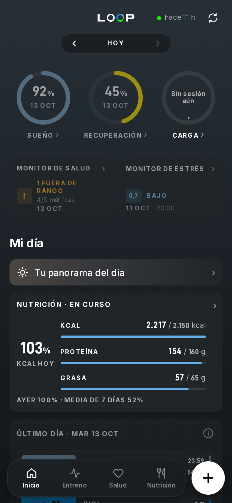
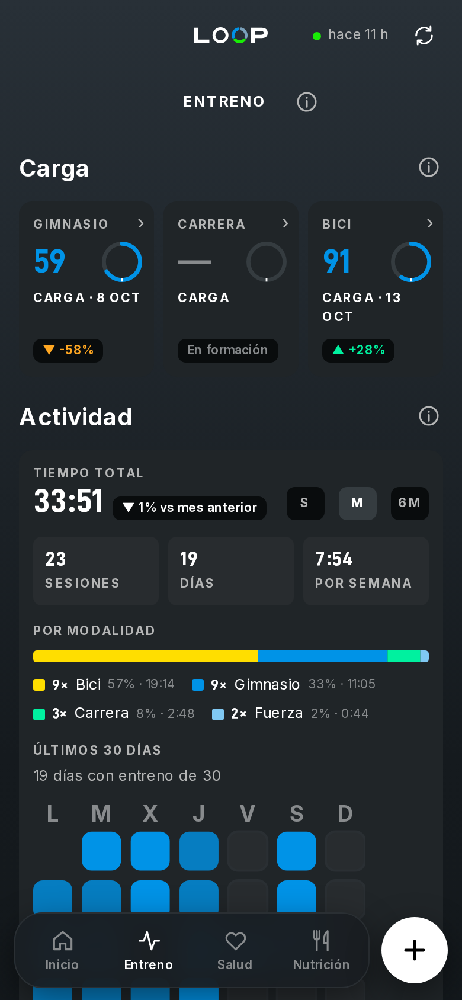
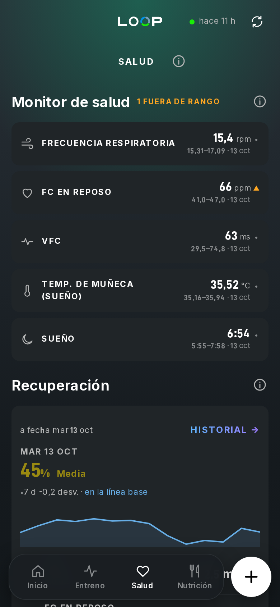
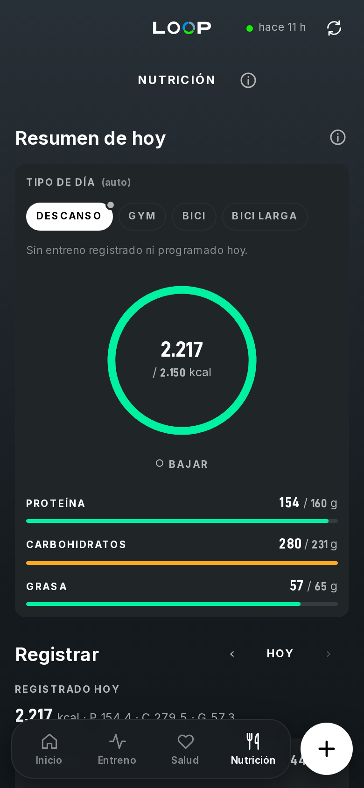
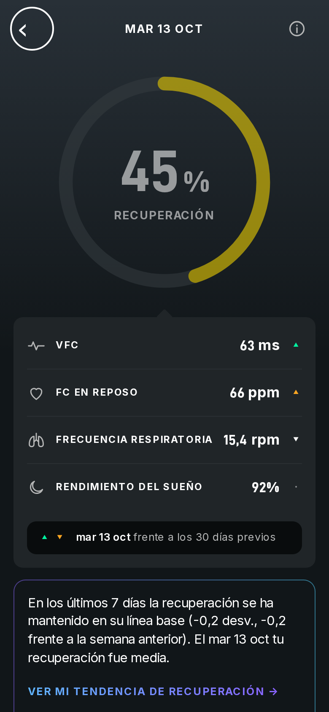
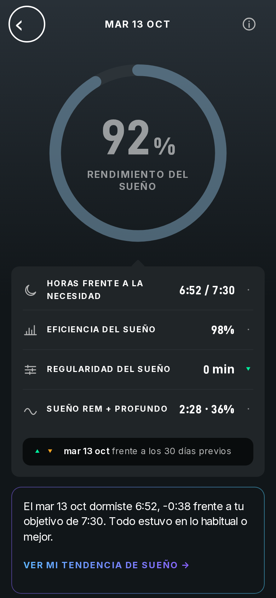
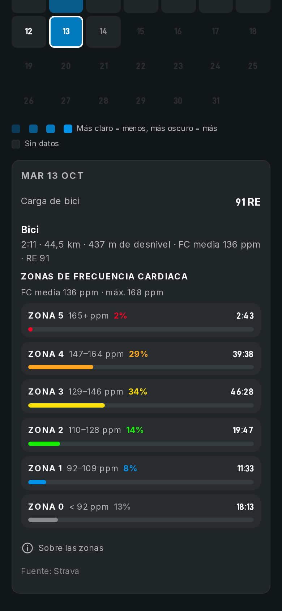
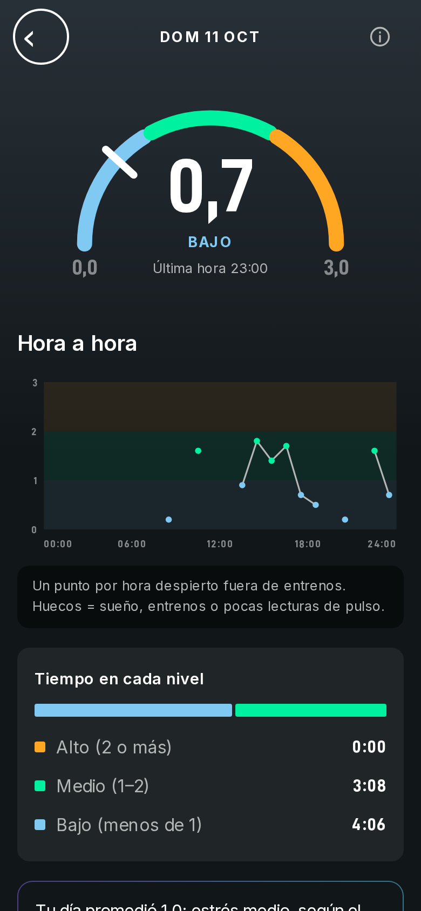
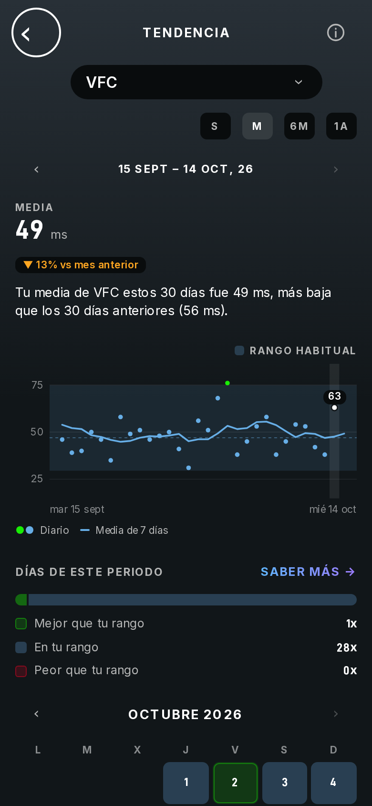
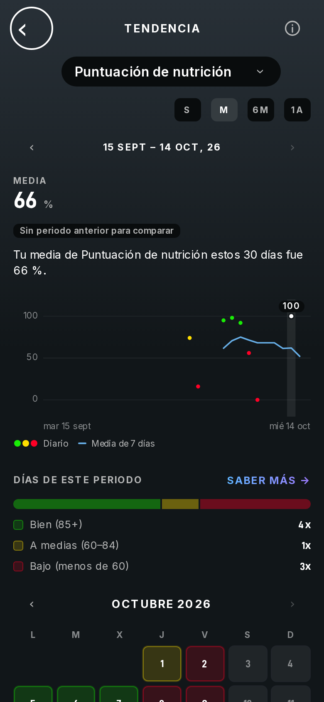

> [English](README.md) · **Español**

# LOOP

[](https://github.com/mralexsaavedra/loop/actions/workflows/ci.yml)
[](https://hub.docker.com/r/mralexandersaavedra/loop-server)
[](LICENSE)

Un espacio personal de coaching de salud y nutrición basado en datos y manejado con
[Claude Code](https://claude.com/claude-code). Tú aportas tus propios datos (la exportación de Apple Health, el
registro de comidas, el programa de entrenamiento); Claude te hace la entrevista inicial, analiza las tendencias
reales con una metodología documentada y responde a través de cuatro subagentes coach. Además, un paso de
compilación lo convierte todo en una única página de panel autocontenida. **No es consejo médico** (consulta el
[Aviso legal](#aviso-legal)): no sustituye a un médico ni a un dietista-nutricionista titulado.

Tus datos nunca salen de tu disco: todos los archivos personales están en `.gitignore`, y un hook de protección
impide que Claude los incluya en un commit ([Privacidad](#privacidad)).

<p align="center">
  
  
  
  
</p>

## Por qué existe

Los wearables de recuperación son muy buenos diciéndote cómo está tu cuerpo (sueño, recuperación, esfuerzo,
estrés), pero no dicen nada de lo que has comido. Las apps de alimentación cuentan tus macros y no saben nada del
sueño de anoche ni de la salida en bici de hoy. Y ninguna de las dos puede *hacer* nada con la otra mitad.

Inspirado en las apps de recuperación al estilo de WHOOP, este repositorio reúne las dos mitades en un solo sitio,
en archivos normales en tu propio disco:

- **Un panel al estilo de WHOOP** (la página se llama **LOOP**): sueño, recuperación, carga de entrenamiento,
  estrés, variabilidad de la frecuencia cardiaca, composición corporal. Cada tarjeta abre su propio historial.
- **Además, el registro de comidas** que les falta a esas apps: lo que has comido, frente a unos objetivos que
  siguen tu meta (definición / mantenimiento / volumen) y el entrenamiento del día (descanso, gimnasio, bici,
  salida larga).
- **Además, un agente que puede leerlo todo.** Como todo son archivos locales y una pequeña API local, Claude Code
  ve el cuadro completo a la vez: sueño, VFC, cada entrenamiento, cada comida, tu objetivo, tu próxima carrera.
  Así puede hacer cosas que ninguna app por sí sola puede:
  - preparar las sesiones de la semana que viene conociendo tu carga, tu recuperación y las semanas que quedan
    hasta la carrera;
  - decirte qué cenar con los macros que te quedan y los productos que de verdad compras, y registrarlo por ti;
  - escribir un informe semanal que revisa con números, no con impresiones, las acciones de la semana anterior.
- **Subagentes especialistas.** Un generalista no basta: `cycling-coach`, `hybrid-coach` (HYROX),
  `training-coach` (cualquier otro deporte) y `nutrition-coach` responden solo a su campo, leen las fuentes que
  *tú* elegiste para ese campo y citan cada afirmación. Puedes añadir los tuyos como un archivo Markdown en
  `.claude/agents/`.

También puede funcionar **en segundo plano**: el servidor LOOP (dos imágenes Docker) sincroniza Apple Health,
Strava y el registro de comidas por su cuenta y reconstruye la página cada hora, y una sesión de Claude Code en
una máquina siempre encendida junto a ellos sigue trabajando con los mismos datos, con la memoria de
[Engram](https://github.com/Gentleman-Programming/engram) para recordar tus decisiones entre sesiones.

*LOOP es un proyecto independiente, sin relación con WHOOP ni respaldado por WHOOP.*

### Cómo es un día con LOOP

Conversaciones reales, en la instalación del propio autor:

| Tú dices | El agente |
| --- | --- |
| "Para comer tomo 3 contramuslos de pollo con piel" | Los registra en el registro de comidas (teniendo en cuenta la piel y el hueso) y te dice cuánta grasa te queda para la cena |
| "Esta noche 200 g de esta salchicha de pavo" + una foto de la etiqueta | Crea el producto a partir de la etiqueta, lo registra y lo compara con una salchicha de cerdo normal |
| "Strava me ha estropeado la media, paré 30 min en la tienda de bicis" | Lee los datos de la salida, encuentra la parada y te da la media real en movimiento |
| "¿Qué tal ha ido hoy, entreno y comida?" | Cruza la salida (potencia, FC) con lo comido en el día y señala lo que se quedó corto |
| "Análisis" | Ejecuta `/analysis`: sincronización, frescura de los datos, tendencias, seguimiento de las acciones del último informe y 2–4 nuevas |

### Capturas de pantalla

Datos reales de la página del autor (sin la ficha de perfil). Cada tarjeta abre una vista de historial:

<p align="center">
  
  
  
  
  
  
</p>

¿Quieres verla sin tus propios datos? `npm run build:example` genera la misma página a partir de un conjunto de
datos de demostración sintético.

## Qué incluye

| Pieza | Qué hace |
| --- | --- |
| Entrevista inicial | En un clon recién creado, Claude te entrevista y escribe tu perfil, tu punto de partida y la configuración de los coaches ([`docs/onboarding.es.md`](docs/onboarding.es.md)) |
| Skill `/analysis` | Sincronización → comprobación de frescura → tendencias según [`analysis/methodology.md`](analysis/methodology.md) (en inglés) → un informe con fecha en `analysis/reports/` |
| Subagentes coach | `cycling-coach`, `hybrid-coach`, `training-coach`, `nutrition-coach`: solo lectura, citan cada afirmación y se configuran con tu `profile/coaches.md` (en `.gitignore`) ([`docs/knowledge-base.md`](docs/knowledge-base.md), en inglés) |
| La página | `npm run generate` → `web/dist/personal/index.html`: pestañas Inicio, Entreno, Salud y Nutrición; toca cualquier tarjeta para ver su historial ([un recorrido por la página](docs/guides/page-tour.es.md)) |
| Hook de protección | Bloquea añadir a la fuerza archivos ignorados (personales) y sacarlos de `.gitignore` ([`docs/guard-hook.md`](docs/guard-hook.md), en inglés) |

`CLAUDE.md` es el manual de uso que Claude lee en cada sesión. Todas las guías y documentos de referencia
aparecen en el [índice de la documentación](docs/README.md) (en inglés).

## Requisitos previos

LOOP tiene dos piezas; instala una o las dos:

| Pieza | Para qué | Necesita |
| --- | --- | --- |
| **Servidor** | La página en tu red doméstica, el registro de comidas, el diario, la sincronización con el Atajo de iOS, Strava | Una máquina siempre encendida con Docker Compose (imágenes para `linux/amd64` y `linux/arm64`; probado en un equipo Linux amd64). Sin clonar nada y sin Node.js |
| **Coach** | Los análisis con IA, los subagentes coach, un agente que registra la comida por ti | Un clon de este repositorio, **Node.js `>=22.12`**, git y **[Claude Code](https://claude.com/claude-code)** |

Las dos necesitan **un iPhone (Apple Health)** para los datos de salud. Opcional para el coach:
**[Engram](https://github.com/Gentleman-Programming/engram)**, memoria persistente entre sesiones (sin él, el
estado duradero vive en los archivos versionados y en `CHANGELOG.md`).

## Instalación

También puedes ejecutar `/setup` en Claude Code (desde un clon) y te guiará por cualquiera de los dos caminos:
comprueba lo que ya está instalado y avanza paso a paso.

### Servidor — la página, el registro de comidas y la sincronización del iPhone (Docker, sin clonar)

Lo que obtienes: la página en `http://<server-ip>:8090` desde cualquier móvil u ordenador de casa, un registro de
comidas y un diario que rellenas desde la página, un botón Sincronizar que reconstruye la página con tus datos más
recientes (también se reconstruye cada hora) y la dirección a la que el Atajo de iOS envía tus datos de Apple
Health. Tres contenedores: el `postgres` oficial, la imagen `loop-server` (el servicio de datos; también genera la
página) y la imagen `loop-web` (sirve la página).

1. **Descarga los dos archivos** en una carpeta propia y crea la carpeta de archivos antes del primer arranque
   (si no, Docker la crearía con root como propietario):

   ```sh
   mkdir loop && cd loop
   curl -fsSLO https://raw.githubusercontent.com/mralexsaavedra/loop/v1.0.1/docker/docker-compose.yml
   curl -fsSL -o .env https://raw.githubusercontent.com/mralexsaavedra/loop/v1.0.1/docker/.env.example
   mkdir -p files/import files/manuals files/documents
   ```

2. **Configura los secretos** (se generan en el propio archivo, sin mostrarse nunca) y revisa el resto de `.env`
   (puertos, direcciones):

   ```sh
   chmod 600 .env
   sed -i.tmp "s/^INGEST_TOKEN=.*/INGEST_TOKEN=$(openssl rand -hex 32)/; s/^POSTGRES_PASSWORD=.*/POSTGRES_PASSWORD=$(openssl rand -hex 24)/" .env && rm .env.tmp
   ```

3. **Arráncalo:** `docker compose up -d` descarga las imágenes y arranca los tres contenedores. `docker compose ps`
   muestra los tres como `healthy` en menos de un minuto; `curl -s -o /dev/null -w '%{http_code}\n' http://127.0.0.1:8088/healthz`
   imprime `200`.
4. **Abre la página** en `http://<server-ip>:8090`. En un servidor nuevo se abre un asistente que hace una
   pregunta cada vez (sobre ti, los deportes que practicas, tu objetivo y una breve comprobación de seguridad) y
   calcula tus calorías y macros de partida para cada tipo de día. Todo lo que hay en la página funciona sin
   Claude Code.

   **Idioma:** en la página, toca tu foto (el avatar redondo de la barra superior) para abrir la hoja de perfil
   y elige **Idioma** (es / en). O bien pon `HC_LOCALE=es` en `.env` (`docker/.env` en un clon) y ejecuta
   `docker compose up -d`. El ajuste de la página tiene prioridad sobre `HC_LOCALE`.
5. **Tu historial de Apple Health:** iPhone → Salud → tu foto → *Exportar todos los datos de salud*. Copia el zip,
   tal cual, en `files/import/` en el servidor y pulsa **Sincronizar** en la página: el servidor lo importa (una
   primera importación de una exportación grande tarda uno o dos minutos; el mismo zip dos veces se omite). Repítelo
   con una exportación nueva cuando quieras.
6. **El Atajo de iOS** lo mantiene al día entre exportaciones: [importa el que ya está hecho](https://www.icloud.com/shortcuts/ceb66eea36fc434a9d2f910421dd18aa)
   y sigue [`docs/ios-shortcut.es.md`](docs/ios-shortcut.es.md) → Instalar el Atajo ya hecho. El token que te pide
   es `INGEST_TOKEN` en `.env` (`grep '^INGEST_TOKEN=' .env`, léelo en tu propia pantalla).
7. **Strava** (opcional): crea la app de la API ([`services/loop-ingest/README.md` → Getting the Strava credentials](services/loop-ingest/README.md#getting-the-strava-credentials-once-5-minutes), en inglés),
   pon `STRAVA_CLIENT_ID` y `STRAVA_CLIENT_SECRET` en `.env` y después:

   ```sh
   docker compose up -d
   docker compose exec loop-server node services/loop-ingest/scripts/strava-auth.js --print
   ```

   Te pide el código de la página de autorización e imprime una línea `STRAVA_REFRESH_TOKEN=...`: ponla en `.env`
   y vuelve a ejecutar `docker compose up -d`.

Para actualizar: [`docs/guides/upgrading.es.md`](docs/guides/upgrading.es.md) (`docker compose pull && docker compose up -d`);
si algo no funciona: [`docs/guides/troubleshooting.es.md`](docs/guides/troubleshooting.es.md); cómo funciona el
servidor y su modelo de seguridad: [`docs/lan-services.md`](docs/lan-services.md) (en inglés). Una segunda
instalación para otra persona en el mismo equipo: una segunda carpeta con su propio `HC_INSTANCE` y sus puertos en
`.env`.

### Coach — análisis con IA en Claude Code (un clon)

1. **Instala las herramientas** (una vez): [Node.js 22 LTS](https://nodejs.org/) (`node -v` imprime `v22.12` o
   posterior), [git](https://git-scm.com/downloads) y [Claude Code](https://claude.com/claude-code).
2. **Descarga el código:**

   ```sh
   git clone https://github.com/mralexsaavedra/loop.git
   cd loop
   npm ci
   ```

3. **Conéctalo a tu servidor** y trae sus datos. En el propio servidor:

   ```sh
   npm run connect -- http://127.0.0.1:8088
   npm run sync
   ```

   `connect` te pide el token (`INGEST_TOKEN` en el `.env` del servidor) sin mostrarlo en pantalla, para que nunca
   quede en el historial de la terminal, y guarda la dirección y el token en `loop-data/server.json` (modo 600, en
   `.gitignore`): cada `npm run sync` posterior, en cualquier terminal, lo usa (`npm run connect -- --forget` lo
   borra). Comprobación: `npm run sync` imprime `Client mode: ...` y una línea `Mirror: N files ...`: el clon ya
   tiene una copia de los datos del servidor en `loop-data/`. Desde otro ordenador usa `http://<server-ip>:8088`,
   que necesita el puerto de datos accesible en la red local: `INGEST_BIND` en el `.env` del servidor es
   `127.0.0.1` (solo la propia máquina) por defecto; ponle la IP local del servidor y ejecuta `docker compose up -d`
   allí (sin exponerlo a internet:
   [Network and bind address](docs/lan-services.md#network-and-bind-address), en inglés). Detalles:
   [`docs/data-pipeline.md` → Coach as a client](docs/data-pipeline.md#coach-as-a-client-of-a-loop-server) (en inglés).
4. **Abre Claude Code y saluda** (`claude` dentro de la carpeta). Si aún no hay perfil, hace la entrevista inicial
   y escribe por ti `profile/about-me.md`, `profile/baseline.md` y `profile/coaches.md` (todos en `.gitignore`).
   ¿Prefieres rellenarlos tú? Copia cada `*.example.md` → `*.md`.
5. **Pide un análisis**, o escribe `/analysis`. Vuelve a ejecutar `npm run sync` cuando quieras los datos más
   recientes.

#### Coach sin servidor (solo local)

¿No tienes servidor? El coach también funciona solo con una exportación de Apple Health:

1. Los pasos 1–2 de arriba.
2. **Exporta Apple Health:** iPhone → Salud → tu foto → *Exportar todos los datos de salud*. Pon el zip, tal cual,
   en `loop-data/files/import/` (antes, `mkdir -p loop-data/files/import`; `loop-data/` es la carpeta en
   `.gitignore` que guarda todos tus datos personales) y ejecuta `npm run import:health` (guarda en caché pequeños
   CSV por métrica; vuelve a ejecutarlo tras cada exportación nueva, el mismo zip dos veces se omite). ¿Lo
   descomprimiste tú? Pon ahí `export.xml` y ejecuta `node data/apple-health/extract.mjs`. ¿Aún no tienes
   exportación? Mira primero la demo: `npm run build:example` y abre `web/dist/example/index.html`.
3. Los pasos 4–5 de arriba.
4. **Ver la página:** `mkdir -p loop-data/cache`, copia `data/nutrition/plan-data.example.json` →
   `loop-data/cache/plan.json` (y, si quieres, `data/training/training-data.example.json` →
   `loop-data/cache/training.json`, `profile/profile.example.json` → `loop-data/cache/profile.json`), después
   `npm run generate` y abre `web/dist/personal/index.html`.

**Tu objetivo para los análisis de Claude** (definición / mantenimiento / volumen y un peso objetivo) normalmente
viene de los ajustes del servidor. Sin servidor, díselo a Claude durante la entrevista inicial, o crea tú mismo
`loop-data/profile/settings.json` (en `.gitignore`):

```json
{ "goal": "cut", "targetWeightKg": 70 }
```

La página guarda en el navegador el objetivo que elijas en ella.

**Idioma:** la página (y los nombres de los alimentos en `plan-tables.md`) sigue, por este orden: el Idioma que
elegiste en la hoja de perfil de la página de la LAN (una vez que `npm run sync` lo ha traído), si no `HC_LOCALE`
en tu entorno, si no el `"locale"` de `loop-data/cache/plan.json`, y si no, inglés. Tras un cambio, vuelve a
ejecutar `npm run generate`.

Extras opcionales para el coach:

| Quieres | Haz | Documento |
| --- | --- | --- |
| Tu propio plan de nutrición | Edita `loop-data/cache/plan.json` (raciones, plan del día, `targets.byGoal`); la base de alimentos `ingredients.json` viene versionada. Con servidor, súbelo allí: `npm run documents -- push plan` | [`docs/guides/your-plan.es.md`](docs/guides/your-plan.es.md) |
| La sesión programada de hoy | Rellena `loop-data/cache/training.json` por fecha (Claude puede transcribir el PDF de un entrenador) | [`docs/guides/your-plan.es.md`](docs/guides/your-plan.es.md) → El plan de entrenamiento |
| Tu propia base de conocimiento | Transcripciones de los expertos que *tú* elijas, que leen los subagentes coach | [`docs/knowledge-base.md`](docs/knowledge-base.md), [`knowledge/README.md`](knowledge/README.md) (en inglés) |
| Probarlo sin datos | `npm run build:example` y abre `web/dist/example/index.html` (datos de demostración sintéticos; sus días terminan el 28 sep 2026, así que abre cualquier tarjeta para ver el historial) | [`data/demo/README.md`](data/demo/README.md) (en inglés) |

La ingesta de la base de conocimiento (`scripts/ingest-youtube.mjs`) usa la herramienta externa
[`yt-dlp`](https://github.com/yt-dlp/yt-dlp), que es opcional; sin ella, los coaches responden a partir de la base
de evidencia y de tus datos. `knowledge/` está en `.gitignore`: es **solo para uso personal; respeta los derechos
de los creadores** y no lo publiques nunca.

### Desarrollo: modo host

Antes de las imágenes, el servidor funcionaba desde un clon: `services/loop-ingest` y `services/loop-web` como
stacks de Docker Compose, con la página generada en el propio equipo por `services/loop-web/refresh.sh` (un archivo
disparador, una unidad path de systemd y una línea de cron cada hora). Se mantiene para desarrollo y para las
instalaciones que aún no han pasado a las imágenes
([`services/loop-web/README.md` → Install (host)](services/loop-web/README.md#install-host), en inglés; necesita un
equipo Linux con systemd y Node.js). Para pasar una de esas instalaciones a las imágenes, en el sitio y
conservando sus datos:
[`docs/guides/upgrading.es.md` → Pasar una instalación en modo host a las imágenes](docs/guides/upgrading.es.md#pasar-una-instalación-en-modo-host-a-las-imágenes).

## Privacidad

Los datos de salud en bruto son **datos sensibles de nivel médico** y quedan fuera de git mediante `.gitignore`.
Solo viven en el disco local. El árbol versionado es **solo el framework + las herramientas + las plantillas
`.example`**, nunca tus datos. (La única excepción es deliberada: `docs/screenshots/` contiene la página del propio
autor, publicada por decisión suya.) El hook de protección ([`docs/guard-hook.md`](docs/guard-hook.md), en inglés)
impide que Claude añada a la fuerza archivos ignorados o los saque de `.gitignore`.

Antes de subir nada a un remoto, confirma que no hay nada personal preparado para commit ni en el historial:

```sh
git status                 # working tree clean of personal data
git log --all --name-only --format= -- profile/ data/ loop-data/ | sort -u   # should list only .example / tooling / .gitkeep / the synthetic data/demo
```

Si alguna vez hiciste commit de datos reales por error, reescribe el historial (por ejemplo con `git filter-repo`)
antes de hacerlo público: `.gitignore` no elimina con efecto retroactivo los datos de commits anteriores.

## Aviso legal

Las recomendaciones de este repositorio son orientaciones generales derivadas de tus datos y de principios
habituales de nutrición y entrenamiento. **No** sustituyen a un médico colegiado ni a un dietista-nutricionista
titulado, especialmente ante cualquier enfermedad, medicación o dieta prescrita.

## Licencia

MIT; consulta [LICENSE](LICENSE). La licencia cubre el framework y las herramientas. Los datos que añadas son tuyos
y se quedan en local (en `.gitignore`).

Datos de alimentos de [Open Food Facts](https://world.openfoodfacts.org), © colaboradores de Open Food Facts,
disponibles bajo la [Open Database License (ODbL)](https://opendatacommons.org/licenses/odbl/1-0/). La búsqueda de
productos de la página local (código de barras / nombre) la consulta en directo y la cita bajo la búsqueda y en
el formulario de un producto rellenado con Open Food Facts.
